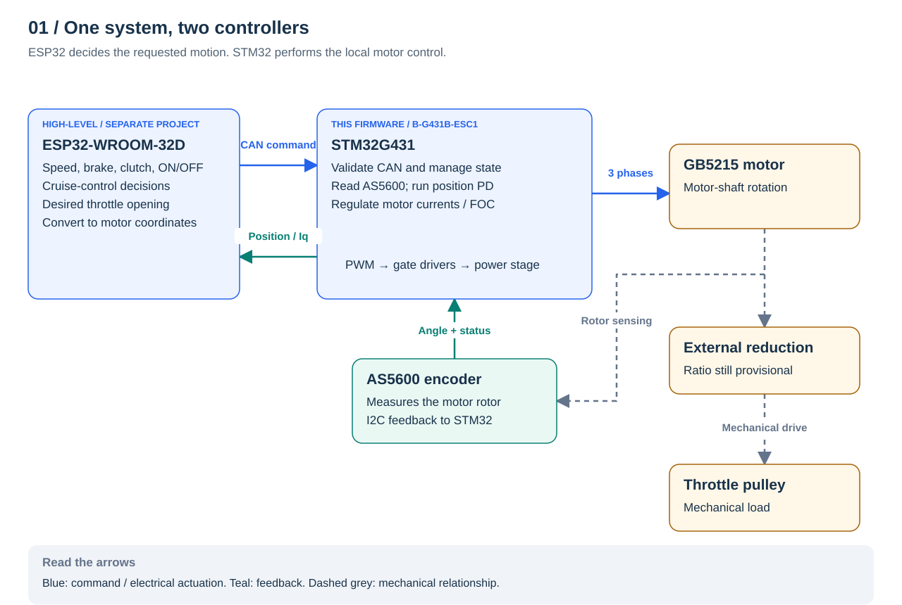
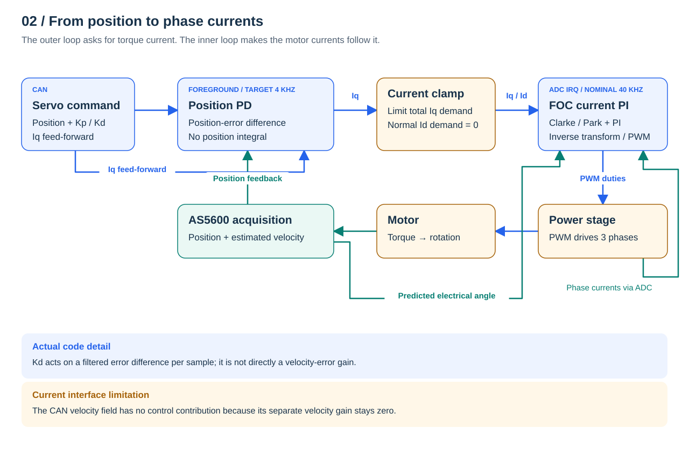
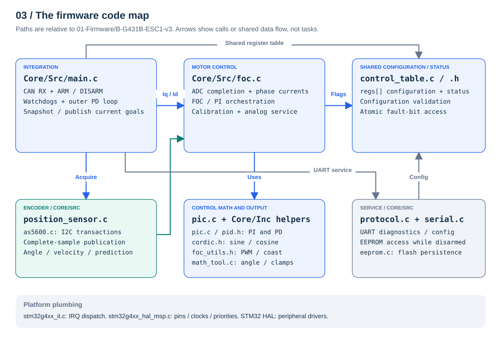
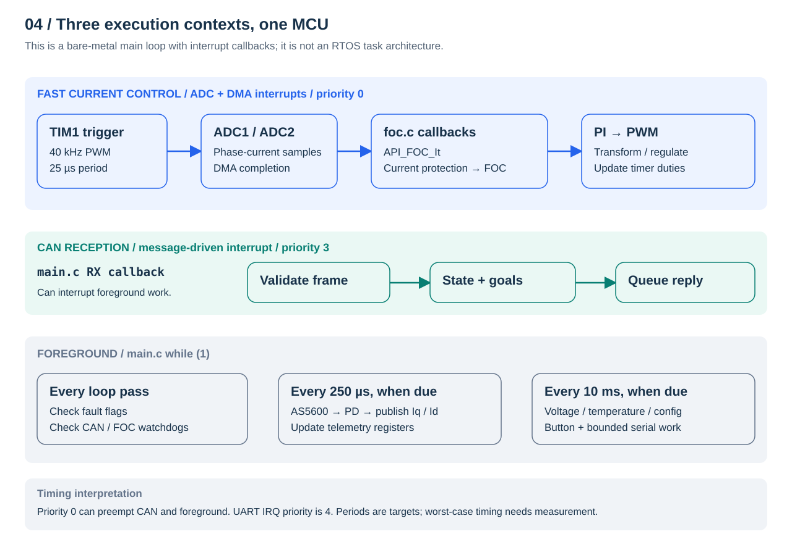
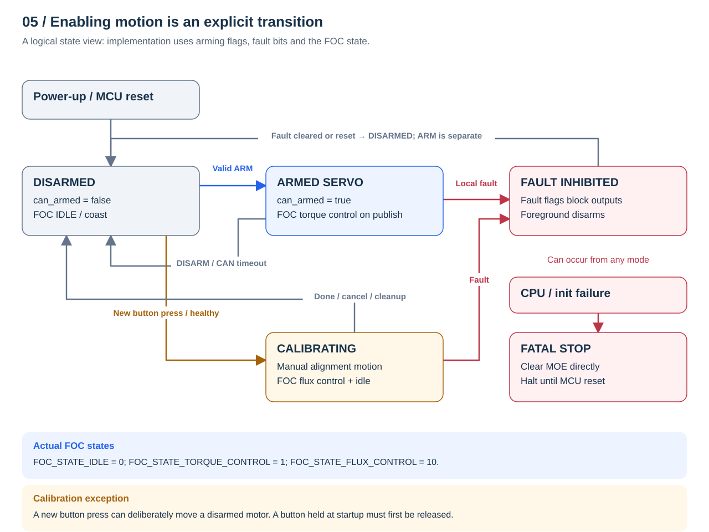
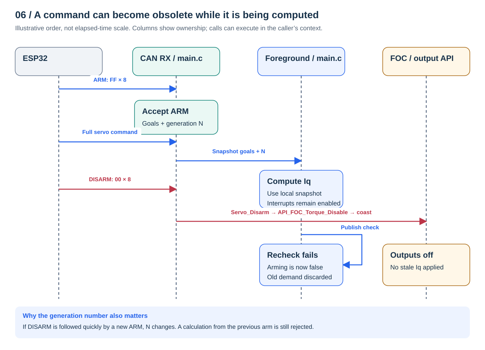
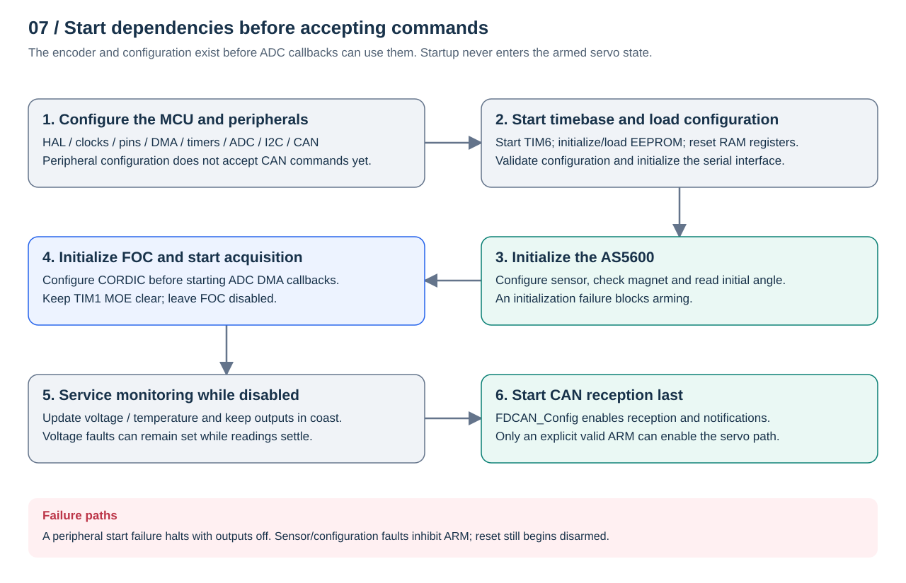

# Visual architecture guide

**G431-Servo · branch `simplified` · B-G431B-ESC1 + AS5600**

This guide connects the system concept to the implementation in
`01-Firmware/B-G431B-ESC1-v3`. Read sections 1–2 for the control concept, then
sections 3–7 to navigate the code. The diagrams describe the current firmware;
the ESP32 and mechanical assembly are the surrounding system design, outside
this repository. Hardware timing and release behavior still need bench validation.

[Open the illustrated HTML edition](architecture.html) ·
[Exact protocol and limits](servo-drive.md) ·
[Project decisions](system-architecture.md) ·
[Audit and remaining work](simplified-audit.md)

## 1. System boundaries: who owns each decision?



The **ESP32** decides what motion is wanted: read speed and rider inputs,
calculate throttle opening, and express that opening in motor coordinates. Its
TWAI controller communicates through the external SN65HVD230 CAN transceiver.
The diagram groups the transceiver into the CAN connection for readability.

The **STM32** makes the local motor follow the command: validate messages, read
rotor angle, calculate torque-current demand, run FOC and monitor local faults.
The power stage supplies the three motor phases. The AS5600 feeds the STM32
directly over I2C; the ESP32 does not participate in commutation.

The encoder measures the **motor rotor**, not the throttle pulley. All firmware
position and velocity values use motor-shaft units. Transmission ratio,
throttle travel and load are mechanical/calibration decisions; the firmware
does not assume a final gear ratio. A throttle-spring feed-forward map would
belong on the ESP32 and supply the existing current feed-forward field.

## 2. Control cascade: position becomes current, then PWM



The loops solve different problems. The outer controller turns position error
into **Iq**, the current component used to request torque. The inner current
controller turns Iq/Id errors into voltage demands and PWM duties. **Id** is the
flux-axis current demand; the normal simplified command path leaves it at zero.
AS5600 position and phase-current measurements close the feedback paths.

The current implementation is approximately:

```text
e[k] = limited_position_target - measured_position
d[k] = 0.1 × (e[k] - e[k-1]) + 0.9 × d[k-1]
Iq demand = direction × clamp(2 × Kp_byte × e[k]
                              + 200 × Kd_byte × d[k]
                              + Iq_feedforward,
                              -current_limit, +current_limit)
```

There is **no position integral**. Kd multiplies a filtered error difference
per sample, rather than a velocity error divided by elapsed time. The CAN
velocity target is decoded and limited, but its separate gain stays zero in
the simplified interface, so it currently contributes nothing to Iq. This
diagram deliberately shows the implemented control law; the idealized future
PD/velocity model in the project concept would need a separate change and tuning.

FOC uses Clarke/Park transforms to express measured phase currents in the rotor
frame, PI controllers to produce voltage demands, then inverse transforms and
CSVPWM to update TIM1. `cordic.h` supplies sine/cosine. It is the same basic
current-control stack retained from upstream.

## 3. Code architecture: where each responsibility lives



This firmware is organized as C modules with shared register/state storage.
`main.c` contains both application integration and generated peripheral setup.
There is no separate cruise-control module and no RTOS task scheduler.

All source links below start from the selected firmware variant.

| Responsibility | Entry points and files |
| --- | --- |
| Application and CAN | [`main.c`](../01-Firmware/B-G431B-ESC1-v3/Core/Src/main.c): `main`, `HAL_FDCAN_RxFifo0Callback`, `Servo_Disarm`, `Servo_Check_Watchdogs` |
| Command handoff | `main.c`: `Servo_Get_Command`, `Servo_Publish_Currents`; snapshot plus ARM generation |
| Encoder acquisition and prediction | [`position_sensor.c`](../01-Firmware/B-G431B-ESC1-v3/Core/Src/position_sensor.c): `positionSensor_init`, `positionSensor_update`, `positionSensor_getRadiansEstimation` |
| AS5600 register access | [`as5600.c`](../01-Firmware/B-G431B-ESC1-v3/Core/Src/as5600.c): `AS5600_Init`, `AS5600_CheckMagnet`, `AS5600_GetAngle` |
| Fast current path and calibration | [`foc.c`](../01-Firmware/B-G431B-ESC1-v3/Core/Src/foc.c): `API_FOC_It`, `API_FOC_Torque_Update`, enable/disable APIs, `API_FOC_Calibrate` |
| Control equations | [`pic.c`](../01-Firmware/B-G431B-ESC1-v3/Core/Src/pic.c) implements the PI/PID helpers declared in [`pid.h`](../01-Firmware/B-G431B-ESC1-v3/Core/Inc/pid.h) |
| Trigonometry and PWM | [`cordic.h`](../01-Firmware/B-G431B-ESC1-v3/Core/Inc/cordic.h), [`foc_utils.h`](../01-Firmware/B-G431B-ESC1-v3/Core/Inc/foc_utils.h); these implementations are inline in headers |
| Configuration and fault storage | [`control_table.c`](../01-Firmware/B-G431B-ESC1-v3/Core/Src/control_table.c), [`control_table.h`](../01-Firmware/B-G431B-ESC1-v3/Core/Inc/control_table.h): `regs[]`, configuration validation and fault-bit helpers |
| Serial and flash services | [`protocol.c`](../01-Firmware/B-G431B-ESC1-v3/Core/Src/protocol.c), [`serial.c`](../01-Firmware/B-G431B-ESC1-v3/Core/Src/serial.c), [`eeprom.c`](../01-Firmware/B-G431B-ESC1-v3/Core/Src/eeprom.c) |
| Platform and fatal handling | [`stm32g4xx_it.c`](../01-Firmware/B-G431B-ESC1-v3/Core/Src/stm32g4xx_it.c), [`stm32g4xx_hal_msp.c`](../01-Firmware/B-G431B-ESC1-v3/Core/Src/stm32g4xx_hal_msp.c), [`emergency_stop.h`](../01-Firmware/B-G431B-ESC1-v3/Core/Inc/emergency_stop.h) |

The register table is a shared interface, not a message queue. It holds saved
configuration, command fields and telemetry/fault status. Serial writes are
restricted to disarmed configuration and the runtime LED register; CAN owns the
normal servo command path. Flash persistence does not execute in the fast loop.

## 4. Runtime architecture: what executes when?



The timer/ADC chain drives the fast loop:

```text
TIM1 update → ADC1/ADC2 conversion → DMA completion callbacks
            → API_FOC_It → phase-current protection → API_FOC_Torque_Update
```

The selected counter half-cycle supplies the three phase currents before a FOC
update. Critical routines are placed in CCMRAM by section attributes and the
linker script. The configured rates are:

| Work | Trigger / target | Context |
| --- | --- | --- |
| PWM and current-control updates | 40 kHz nominal; 25 µs PWM period | ADC/DMA interrupts, priority 0 |
| CAN command reception | A received FIFO message | CAN interrupt, priority 3 |
| Encoder and outer servo loop | 250 µs target, 4 kHz | Foreground |
| Voltage, temperature, config, button and serial processing | 10 ms target, 100 Hz | Foreground |
| Fault flags and CAN/FOC watchdog checks | Every normal main-loop pass | Foreground |

Lower numerical interrupt priority is higher urgency. ADC work can preempt CAN
and the foreground. Short critical sections temporarily mask interrupts when
publishing shared data; I2C reads and the outer control calculation run outside
those sections. UART interrupt priority is 4 and supports serial buffering.

These periods describe configuration/scheduling targets, not measured execution
times. I2C errors and flash operations can delay the foreground. Manual
calibration temporarily runs a serviced trajectory: its waits keep encoder and
analog monitoring alive, CAN interrupts still run, and CAN DISARM can cancel it.
The ordinary main-loop schedule resumes after calibration returns.

## 5. States, faults and output ownership



The diagram is a **logical view**, not a C enum listing. Implementation state is
split across `can_armed`, `REG_TORQUE_ENABLE`, the ARM generation, calibration
flags, hardware-fault bits and the FOC state. The actual FOC state values are
IDLE (0), TORQUE_CONTROL (1) and FLUX_CONTROL (10).

An ARM is accepted only with valid configuration, a ready encoder, no fault,
no maintenance/calibration and an initial position inside configured limits.
It initializes goals at the measured position with zero gains/feed-forward;
the foreground then enables FOC on publication. Repeated ARM preserves goals.
An ordinary command while disarmed cannot arm the servo.

`Servo_Disarm` clears arming and goals and calls `API_FOC_Torque_Disable`.
Disabling selects **coast**: MOE, TIM1's main output enable, is cleared while
the timer/ADC acquisition keeps running. Re-enabling waits for valid PWM
preloads to latch. The existing armed overspeed response can brake; it is a
different path from disabled coast, and detected faults take precedence.

A fresh button press requests manual calibration after disarming. Calibration
deliberately energizes the motor even though the normal servo is disarmed.
A held button at startup cannot trigger it until released and pressed again.
Completion or cancellation returns to disabled outputs; a remaining fault
still inhibits ARM. Fatal CPU/initialization paths clear MOE directly and halt.

| Detection | Where it is checked | Result |
| --- | --- | --- |
| CAN elapsed time >1000 ms | `Servo_Check_Watchdogs`, foreground | Disarm; no separate CAN fault bit |
| FOC timestamp age >10 ms | Same foreground helper | Latch FOC timeout and disarm |
| Encoder sample age >1200 µs | Fast angle estimator | Set stale flag; output paths inhibit motion; foreground disarms |
| I2C or magnet-status failure | Encoder acquisition | Preserve complete last valid sample and latch sensor fault |
| Measured phase current >1500 mA, ADC error or CORDIC failure | Fast acquisition/control path | Fault and immediate FOC disable |
| Voltage, temperature or configuration violation | Foreground service / ARM validation | Fault inhibits outputs and foreground disarms |

Clearing a fault condition does not automatically arm the motor. Some faults
remain latched until reset; the exact policy is in [the drive contract](servo-drive.md#fault-behavior).
These are software checks: there is no configured independent MCU watchdog,
and software timing guarantees do not extend to a total MCU lockup.

## 6. Sharing data without accepting obsolete commands



There are three deliberate publication boundaries:

1. **Encoder sample:** I2C data is checked and a complete next angle/velocity/time
   sample is prepared locally. Only the final copy masks interrupts. A failed
   read never publishes partially valid feedback.
2. **Servo command:** `Servo_Get_Command` snapshots the enabled flag, ARM
   generation and all fields together. Control math uses that local snapshot.
3. **Current demand:** `Servo_Publish_Currents` rechecks arming, faults,
   calibration and generation before enabling/updating FOC. The Iq/Id pair is
   published atomically.

DISARM can therefore take effect while the foreground computes a current
demand. If a new ARM arrives before the old calculation finishes, its new
generation still rejects the old result. The four-byte CAN reply is a snapshot
of position and measured Iq; it is not an explicit ARM acknowledgement and
currently carries no state or fault flags.

## 7. Startup order and configuration lifetime



The order prevents an ADC callback from using configuration, encoder or CORDIC
state before it exists. ADC acquisition starts with FOC disabled. CAN reception
is enabled only after those dependencies have been initialized. Sensor failure
or invalid saved settings leave arming inhibited; a peripheral-start failure
uses the fatal stop path.

Saved configuration lives in flash and is loaded into `regs[]`. Runtime RAM
registers are reset at startup, so saved data cannot restore an armed state.
FOC state and encoder history live in static RAM; command snapshots are local
to the foreground iteration.
Configuration writes and requested resets inhibit ARM through a maintenance
flag. Exact flash power-loss/CRC hardening remains follow-up work.

## Read next

- [Drive contract](servo-drive.md): byte layout, units, gain scaling, limits and
  fault clearing policy.
- [System architecture](system-architecture.md): mechanical, power and ESP32
  project decisions, including the items still open.
- [Scoped audit](simplified-audit.md): confirmed defects, changes and prioritized
  remaining work.
- [Regression guide](../tests/README.md): software checks and build commands.

This guide documents firmware structure and intended system boundaries. It does
not replace the pending [bench measurements](servo-drive.md#bench-validation).
