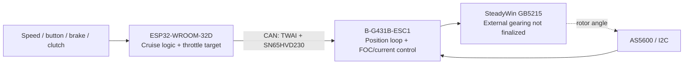

# Cloud continuation handover

Prepared 2026-10-21 for continuing the local G431-Servo development chat.
This is a project handover, not an export of the complete conversation.

Historical snapshot: the branch/commit/start-chat instructions below describe
the original `simplified` handover. For current `professional` development, read
the [roadmap](professional-roadmap.md), [architecture](professional-architecture.md)
and [conventions](firmware-conventions.md), and verify the live checkout first.

The preparation history below is a snapshot. The 2026-10-22 follow-up fixes
and eleven-suite validation supersede its implementation/test summary; consult
the current [audit register](simplified-audit.md#2026-10-22-follow-up).

## Start a new cloud chat

Select repository `toblast/G431-Servo`, branch `simplified`, and provide this
document as context. Paste this opening request:

```text
Continue the G431-Servo project using docs/cloud-handover.md.
Read AGENTS.md and docs/system-architecture.md completely, then read
docs/servo-drive.md, docs/simplified-audit.md and tests/README.md.
Confirm the branch, HEAD and working-tree status before proposing changes.
The local implementation baseline is 0b294f8; the handover commit follows it.
If that baseline is missing, stop firmware changes and report the stale checkout.
Summarize completed work and the highest-priority outstanding work first.
Do not automatically implement deferred design decisions or merge upstream.
For requested implementation, use one logical change per commit, run relevant
regressions and ARM builds, and show the resulting diff and behavior changes.
Hardware testing remains pending; never claim a bench result from software tests.
```

### Transfer prerequisites

At preparation time, local `simplified` was at
`0b294f8c59fe2d5b63b4a7f62ff460b5fbc775f0`, 28 commits ahead of the published
branch. A live `git ls-remote origin refs/heads/simplified` returned
`3f283eac57a3646dbe5f32e9f84f635eb27a50d7`.
The tracked tree was clean; the user's root `AGENTS.md` was untracked.
This handover adds a subsequent documentation change.

Before using a GitHub-backed cloud environment:

1. Include the existing root `AGENTS.md` in a commit so the cloud receives the
   complete project instructions. Preserve its content.
2. Publish `simplified`, including all implementation, documentation and handover
   commits. Verify the remote tip contains `0b294f8` and this document.
3. Configure the cloud environment for this repository and select `simplified`
   explicitly; the repository's default branch may still be `my_v3`.
4. Install the build/test dependencies below in the environment. Local binaries,
   Windows toolchains and ignored directories do not transfer through Git.

Preparing this document did not publish the branch, create a cloud environment
or migrate the original chat. Do not start from the old remote tip and assume
the safety fixes are present. The counts above describe the preparation snapshot,
not a permanent state.

## Project decisions and scope

This is the STM32 local servo drive for a prototype cruise-control actuator for
a 2015 Kawasaki Ninja 300. The high-level controller is a separate ESP32 project.



- Selected firmware: `01-Firmware/B-G431B-ESC1-v3`. Other variants are experiments
  and were outside the scoped audit and patch series.
- GB5215 has no internal gearbox. Approximately 3:1 external spur gearing is a
  provisional mechanical concept. Firmware coordinates are motor-shaft units;
  do not hard-code gearing, throttle travel or unmeasured load assumptions.
- ESP32 owns speed sensing, cruise logic, button, brake/clutch and throttle target
  calculation. STM32 owns encoder, commutation, FOC, local servo/faults and CAN.
- Preserve working FOC math unless a concrete defect justifies a change. Prefer
  small deterministic patches, explicit state transitions and no real-time
  dynamic allocation. Do not add a position integral without a specific request.
- Startup/reset must remain DISARMED. No automatic enabling or startup calibration.
  Ordinary target commands cannot arm. Clearing a fault cannot automatically rearm.
- Initial development is bench-only. No firmware flashing or motor bench result
  has been claimed. Motor reference ratings and final supply/gearing/load require
  verification; they are not established operating limits.
- The user authorized implementation after the original read-only audit and asked
  for one logical change per commit. Visual architecture documentation was also
  requested and completed. No further broad redesign was authorized.

## Read these documents

| Document | Purpose |
| --- | --- |
| `AGENTS.md` | Complete project instructions and workflow; must be transferred |
| `docs/system-architecture.md` | Broader architecture, decisions and open questions |
| `docs/servo-drive.md` | Current selected firmware contract, exact wire layout, control law and fault clearing |
| `docs/simplified-audit.md` | Classified audit, locations, consequences, fixes/commits and remaining priorities |
| `docs/architecture.md` / `docs/architecture.html` | Visual conceptual/code architecture, seven SVG diagrams in `docs/diagrams/` |
| `tests/README.md` | Regression scope, compiler dependencies and build commands |

## Source and call-path map

All paths in this table are relative to `01-Firmware/B-G431B-ESC1-v3`.

| Area | Sources and entry points |
| --- | --- |
| FOC/current acquisition | `Core/Src/foc.c`: ADC DMA callbacks -> `API_FOC_It` -> current protection -> `API_FOC_Torque_Update` |
| Current PI / outer controller | `Core/Src/pic.c`, declarations in `Core/Inc/pid.h`; foreground servo loop in `Core/Src/main.c` |
| Encoder acquisition/prediction | `Core/Src/as5600.c`, `Core/Src/position_sensor.c`: `positionSensor_init`, `positionSensor_update`, `positionSensor_getRadiansEstimation` |
| CAN / ARM / DISARM | `Core/Src/main.c`: `HAL_FDCAN_RxFifo0Callback`, `Servo_Disarm`, `Servo_Get_Command`, `Servo_Publish_Currents` |
| Watchdogs | `Servo_Check_Watchdogs` in `main.c`, sample-age gate in `position_sensor.c` |
| PWM / coast / brake | Inline helpers in `Core/Inc/foc_utils.h`; TIM1 in `main.c`, pin setup in `Core/Src/stm32g4xx_hal_msp.c` |
| CORDIC | `Core/Inc/cordic.h`; the `.c` file is an empty upstream translation unit |
| Configuration / faults / serial | `Core/Src/control_table.c`, `Core/Inc/control_table.h`, `Core/Src/protocol.c` |
| Calibration | `API_FOC_Calibrate` and serviced waits in `foc.c`; release/press button interlock in `main.c` |
| Fatal shutdown | `Core/Inc/emergency_stop.h`, `Error_Handler`, CPU handlers in `Core/Src/stm32g4xx_it.c` |

## Completed implementation

There are 28 local commits after baseline `3f283ea`, ending at `0b294f8` before
this handover. Consult the audit and Git history for individual patch details.

- Initialized control dependencies before ADC callbacks; CAN starts last. Checked
  peripheral/timebase startup failures and required a new button release/press
  before manual calibration after boot.
- Rejected failed/partial AS5600 reads and invalid magnet status; propagated
  initialization failure. Seeded initial velocity, corrected timestamp wrap and
  equality, atomically published complete samples, and hardened fault-flag races.
- Retained only AS5600 acquisition in the selected variant; removed its unused
  AS5048A/PWM alternative and dynamic sensor factory.
- Replaced abbreviated CAN formats with strict full-frame acceptance, bounded
  RX handling, and a buffer large enough for HAL's copy before FD rejection.
- Implemented explicit ARM/DISARM, guarded readiness/configuration/travel, atomic
  command/state publication and arm-generation checks against stale calculations.
- Made watchdog snapshots coherent and wrap-safe; rejected frames do not refresh
  command freshness.
- Changed disabled/fault outputs to coast via TIM1 MOE clear, kept acquisition
  running, and latched safe PWM preloads before re-enabling outputs. Faults
  override the retained armed overspeed brake path.
- Serviced/cancelled manual calibration safely; blocked serial torque/state
  bypasses and limited serial to disarmed configuration/diagnostics and LED.
- Added conservative configuration validation, measured phase-overcurrent trip,
  peripheral/runtime fault handling, bounded CORDIC waits and fatal MOE shutdown.
- Reported persistence failures and blocked ARM during configuration maintenance.
- Consolidated nine regression suites; documented the exact drive contract,
  classified audit and conceptual/code architecture with drawings.

## Contract to preserve

- Classic CAN, 1 Mbit/s, standard 11-bit data frames, exactly 8 bytes, no BRS.
  Command ID is `REG_ID` (default 1), reply ID is `0x10 + REG_ID`.
- Eight `FF` bytes = ARM; eight zero bytes = DISARM. All other payloads are servo
  commands accepted only while armed. Out-of-limit target values are clamped.
- Fields: signed little-endian position (bytes 0-1, 0.1 motor degree), velocity
  (2-3, motor degrees/s), Iq feed-forward (4-5, mA), Kp byte (6, multiplier 2),
  Kd byte (7, multiplier 200).
- ARM initializes a measured-position hold with zero gains/feed-forward; repeated
  ARM is idempotent. Only accepted ARM/servo frames refresh the CAN timestamp.
- CAN timeout trips at elapsed time >1000 ms plus foreground latency. FOC age
  threshold is 10 ms; encoder age threshold is 1200 us. No independent MCU
  watchdog is configured, and foreground/CPU stalls have no guaranteed timeout.
- CAN replies remain four bytes: signed position (0.1 degree) and measured Iq
  (mA). They do not report acceptance, arming or faults and may be dropped.
- PWM/FOC configured rate is 40 kHz; encoder/outer loop target is 4 kHz;
  voltage/temperature service target is 100 Hz. These are not measured guarantees.
- Command current defaults to 500 mA, capped at 1 A; measured phase-current trip
  is >1.5 A. Rotor speed setting is capped at 360 degrees/s. Encoder is 12-bit.
  Old incompatible EEPROM settings prevent ARM. Actual pole pairs/alignment/travel
  must be configured; inherited 14 pole pairs and +/-800 degree travel are not
  validated GB5215/throttle settings.
- Current PI and Clarke/Park/PWM math were retained. Actual outer Kd operates on
  filtered position-error difference per sample, not directly on velocity error.
  The velocity target has zero control contribution because its separate gain is
  zero and not writable through simplified interfaces. This is documented and
  deferred, not an implemented physical PD velocity law. No outer integral added.
- Manual calibration intentionally energizes a free rotor while disarmed; DISARM
  cancels it. Calibration ends in coast, never armed. See the drive contract for
  prerequisites, result codes, exact fault bits and reset/clearing policies.

## Validation and cloud setup

Previously recorded validation at the implementation/documentation baseline:
all nine native regression suites passed (including 240 CAN assertions), and
both `-Og` and separate `-O2` ARM builds passed using Arm GNU 14.3.rel1.
These results were not rerun to prepare this handover. Native tests use mocked
peripherals and do not establish motor behavior, gate levels or execution timing.
An inherited CCMRAM RWX LOAD-segment linker warning remains.

The environment needs PowerShell (`pwsh` on Linux), native GCC, GNU Make and the
Arm GNU bare-metal toolchain (`arm-none-eabi-*`), or explicit compiler paths.
The test runner is PowerShell, not Bash; review portability before assuming a
Linux environment can use every Windows-tested command unchanged.

From the repository root, using PowerShell:

```powershell
./tests/run.ps1 -Compiler /path/to/native/gcc
make -C 01-Firmware/B-G431B-ESC1-v3 -j4 all
New-Item -ItemType Directory -Force 01-Firmware/B-G431B-ESC1-v3/build/optimized
make -C 01-Firmware/B-G431B-ESC1-v3 -j4 all BUILD_DIR=build/optimized OPT=-O2 DEBUG=0
```

Use `GCC_PATH=<toolchain-bin>` if the ARM toolchain is not on PATH. Never flash
hardware from a cloud task. Do not claim new test/build success without running
the corresponding commands against that task's saved sources.

## Upstream comparison already completed

The user wanted to avoid losing changes from the upstream fork chain:

```text
pat92fr/FOC2 (main)
  -> ghent360/G431-Servo (my_v3)
     -> toblast/G431-Servo (my_v3 / simplified)
```

Comparison snapshot:

| Ref | Commit |
| --- | --- |
| Common ancestor | `f8079e86169471aa4616ab1352efe0b7d0bf8173` |
| FOC2 `main` | `810f3ccd665fbb1aea3fbb905a8d9c4a9f213185` |
| ghent `my_v3` / local implementation baseline | `3f283eac57a3646dbe5f32e9f84f635eb27a50d7` |
| Local `simplified` before this handover | `0b294f8c59fe2d5b63b4a7f62ff460b5fbc775f0` |

FOC2 vs `my_v3`: 15 commits unique to FOC2, 118 unique to the fork.
FOC2 vs the local implementation/documentation tip: 15 vs 146. Ahead and behind
describe divergent ancestry; they do not prove 15 missing features.

The prior content review found:

- FOC2 CAN IRQ fix `38fa7b8` targets v2. The selected v3 already has equivalent
  handler/NVIC/vector/notification plumbing; do not blindly cherry-pick v2 files.
- GUI changes include visibility/settings changes and current-plot denominator
  adjustments using `max_current + 100`. Those adjustments are not all present
  in current GUI V2/V3; they are optional GUI hardening, not a missed FOC fix.
  The upstream adjustment is incomplete for another trace, so review all traces
  rather than assuming the upstream patch fully solves zero denominators.
- The rest is README/history/merge material and a license-year change; MIT license
  terms are unchanged. No additional missing FOC/current/encoder implementation
  fix was found among those 15 commits at the compared refs.

No merge, cherry-pick or firmware change was made for this comparison. The bare
comparison clone exists only in ignored `tmp/upstream-review-20261021.git` on
the original PC and will not be in a cloud checkout. Re-fetch the named public
repositories if repeating the analysis; report any changed upstream tips.

## Remaining priorities and deferred decisions

1. **Hardware bench gates:** measure startup/reset/DISARM/fault outputs and
   coast-to-enable behavior; verify back-drive/release and independent current
   cutoff. This cannot be completed by a cloud code review.
2. **Timing and calibration:** measure actual 40 kHz FOC budget, CORDIC margin,
   I2C/4 kHz sample timing, current-sense accuracy, pole pairs and direction.
3. **Abnormal-condition campaign:** missing/disconnected encoder, CAN loss,
   wrong ID/DLC/type, continuous malformed traffic, CAN bus-off, calibration
   cancellation, independent controller resets and low-current mechanical stall.
4. **Targeted software follow-ups:** saturate extreme telemetry conversions;
   address saved-configuration integrity/CRC and power-loss behavior explicitly.
   Current flash persistence is a single nontransactional page. Consider an
   independent MCU watchdog only with a deliberate timing/recovery policy.
5. **Explicit design decisions before implementation:** velocity-field purpose,
   derivative-per-sample vs velocity-error damping, armed overspeed braking vs
   latched coast fault, final CAN timeout and minimal fault/state telemetry.
   Telemetry expansion was deferred until the command contract is stable.
6. **Mechanical/ESP32 work:** measure throttle travel/load, choose gearing/supply
   and tune/feed-forward experimentally. Keep high-level cruise, speed, brake,
   clutch and UI logic in the separate ESP32 project.

For any new audit finding, retain the user's classifications: confirmed bug,
robustness issue, documentation mismatch, simplification opportunity, or design
preference. Confirm defects against current source; include path, function,
location, runtime consequence and smallest reasonable fix. Do not reopen an
accepted/deferred policy as an unqualified bug or repeat already completed fixes.
