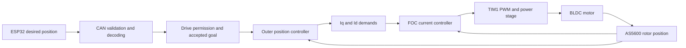
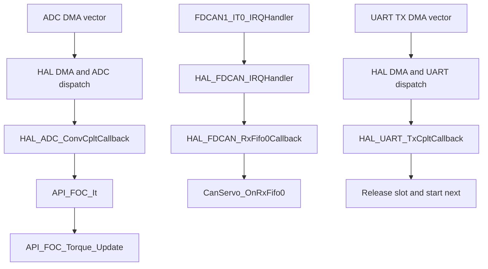
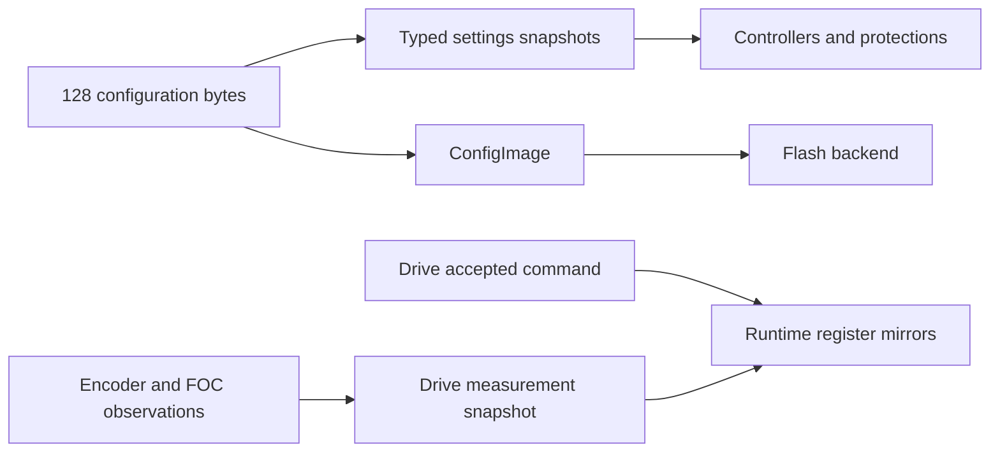

# Read the firmware from the beginning

For branch `standalone`, also read the [standalone module/function guide](../standalone.md).
The catalogue below remains a source snapshot of the `professional` baseline;
the new local cruise modules and their application/interrupt hooks are described
in that supplement.

This guide is for someone who has not opened this codebase before. It describes
the current **professional** firmware at source commit **f9c5c00**, including the
completed refactors and regression audit. It adds no firmware behavior.

The selected project is [01-Firmware/B-G431B-ESC1-v3](../../01-Firmware/B-G431B-ESC1-v3).
Other firmware folders are upstream experiments. The older illustrated guide and
original pseudocode describe `simplified`; use this guide for current names and
the foreground calibration job.

## Repository map

| Location | What belongs there |
| --- | --- |
| Selected `Core/Src` | Application, motor, drivers, generated hardware setup and C-library support. |
| Selected `Core/Inc` | Public contracts/types plus some inline implementations and register macros. |
| Selected `Drivers/STM32G4xx_HAL_Driver` | ST peripheral library. Follow it after reaching a HAL call, not as your first reading assignment. |
| Selected `Drivers/CMSIS` | CPU/device definitions and compiler intrinsics. |
| Selected `startup_stm32g431xx.s` / `.ld` | Vector table/reset setup and memory placement. |
| Selected `Makefile` | Exact compiled source list, compiler flags, linker script and output targets. |
| Selected `.ioc` / generated `MX_*` code | CubeMX peripheral-configuration material. Preserve intentional settings and user-code sections when regenerating. |
| Root `tests` | Host regression suites with hardware mocks; different entry points from firmware `main`. |
| Root `docs` | Current contracts/design/audit plus explicitly labeled historical references. |

## How to use this guide

Read this page first, then follow one example with a reference chapter beside
the code. You do not need to study every peripheral initializer or helper first.

| Read | What you get |
| --- | --- |
| [Application and drive](application.md) | Scheduling, ARM/DISARM, goals, outer controller, CAN and calibration. Start here. |
| [Types and units](types.md) | All named Core types, field meanings, private owners, states, HAL handles and units. |
| [Configuration and faults](configuration.md) | Register encoding, validation, maintenance, flash and fault bits. |
| [Motor and encoder](motor.md) | AS5600 acquisition, FOC, current PI, trigonometry, PWM and numeric helpers. |
| [Serial and telemetry](communications.md) | Packet parsing, configuration commands and UART DMA ownership. |
| [Platform/startup](platform.md) | Reset assembly, generated setup, interrupts, HAL hooks and libc support. |
| [Function and file index](function-index.md) | All 223 C definitions and all 54 Core C/header files. |

Each function entry contains its signature, purpose, source link, direct calls
and direct callers. Private/static functions, inline helpers, retained utilities
and the optional assertion hook are included. Dependencies outside Core are
listed separately; HAL/CMSIS/C-library internals are linked rather than duplicated.

## What this firmware is

The STM32 is the local servo drive. An ESP32 decides the requested throttle
position; this firmware receives a motor-shaft command over CAN and performs
the fast local motor work.



The STM32 does not implement motorcycle speed, brake/clutch inputs or cruise
control. Every application angle/speed refers to the motor shaft. There is no
final external gear ratio in the firmware.

**Iq** is the current component used for torque demand; **Id** is the other
current component in the rotor frame. Torque fields are in mA, not measured Nm.
**FOC** means field-oriented control: transform phase currents into that frame,
regulate them and transform voltage demands back into PWM. You can understand
the application before studying those equations.

## First reading route

1. Open [drive_types.h](../../01-Firmware/B-G431B-ESC1-v3/Core/Inc/drive_types.h).
   Read ServoCommand, DriveCommandSnapshot, DriveMeasurements and DriveStatus
   with the [type explanations](types.md).
2. Open [main.c](../../01-Firmware/B-G431B-ESC1-v3/Core/Src/main.c) at `main`.
   Read startup order and notice the infinite loop only calls App_Process.
   Skip generated MX initializer bodies initially.
3. Read [App_Process](application.md#fn-app-process), then update_servo and
   service. This is the foreground schedule and work distribution.
4. Read [Drive_RequestArm](application.md#fn-drive-requestarm), Drive_Disarm,
   Drive_GetCommand and Drive_PublishCurrents: the normal permission/goal owner.
5. Read [CanServo_OnRxFifo0](application.md#fn-canservo-onrxfifo0), then
   [ServoController_Update](application.md#fn-servocontroller-update).
   You have followed a command from bytes to a current demand.
6. Read [positionSensor_update](motor.md#fn-positionsensor-update) and
   [API_FOC_It](motor.md#fn-api-foc-it) for acquisition and ADC pairing.
7. Follow [API_FOC_Torque_Update](motor.md#fn-api-foc-torque-update) into
   [LL_FOC_set_phase_voltage](motor.md#fn-ll-foc-set-phase-voltage) when ready
   for the current loop and PWM math.
8. Read [calibration](application.md#module-calibration),
   [configuration](configuration.md) and [serial](communications.md) as separate
   features. Use the index for unfamiliar names.

Read a public header for its caller contract, then its implementation for
behavior. A start returning true means accepted, not finished. Calculating
currents does not by itself give permission to publish them.

## The three execution paths

One foreground loop runs alongside interrupts, without an RTOS task scheduler.
These are configured targets, not measured execution guarantees.

| Path | Trigger | Work |
| --- | --- | --- |
| Fast motor | ADC/DMA completions associated with TIM1 | Pair fresh ADC1/ADC2 samples, check phase currents, execute one FOC update, write/coast PWM. Configured PWM target: 40 kHz. |
| CAN | FDCAN FIFO interrupt | Validate/decode a bounded entry batch, change permission/goal and queue feedback. Can interrupt foreground calculations. |
| Foreground | `while (1) App_Process()` | Watchdogs each pass; at most one encoder/servo job per 250 us, one protection/button/serial service per 10000 us and one calibration transition per pass. |

UART/DMA interrupts maintain serial queues. SysTick advances HAL milliseconds;
it does not run the outer controller. TIM6 is a separate free-running 1 MHz
16-bit timer. Unsigned subtraction handles its normal 65.536 ms wrap; it is not
an arbitrary-duration stopwatch.

### Interrupts and callbacks

A callback is your function supplied for another layer to invoke later. Do not
expect a direct call from main to every callback.



Reference call lists show literal Core calls. HAL-invoked hooks are explained
separately: no **direct Core caller** does not mean an unused callback.
Vectors live in stm32g4xx_it.c; clocks/pins/DMA hooks in stm32g4xx_hal_msp.c.

## Walk through a command

1. Startup loads settings, resets runtime/Drive state to disarmed, prepares
   encoder/ADC/FOC dependencies and finally starts CAN reception.
2. Eight FF bytes request ARM. CAN validates the frame and calls Drive_RequestArm.
3. A new accepted ARM captures measured position, zeroes gains/feed-forward,
   increments generation and refreshes its watchdog tick. ARM alone is not a
   completed position-control iteration.
4. A normal eight-byte command becomes a ServoCommand: signed position, velocity,
   Iq feed-forward and two position-gain bytes. No abbreviated formats, Id
   field or independent velocity gain are in that message.
5. At the next servo job App acquires the encoder, copies inputs and asks
   ServoController to calculate currents.
6. Drive_PublishCurrents rechecks live permission, faults, calibration and
   generation before a new arm can enable FOC and publish targets.
7. ADC interrupts independently regulate those currents. CAN replies encode
   the last published measurement snapshot.

Position field `123` means **12.3 motor degrees**, not 123 degrees, throttle
degrees or an angle already multiplied by pole pairs. Pole pairs enter the
electrical-angle calculation inside FOC.

The existing outer calculation is approximately:

```text
error = limited_position_goal - measured_motor_position
filtered_difference = 0.1 * (error - previous_error)
                    + 0.9 * previous_filtered_difference
Iq = direction * clamp(
         2 * Kp_byte * error
       + 200 * Kd_byte * filtered_difference
       + feedforward_mA
       + optional_filtered_velocity_term,
       -configured_current_limit, +configured_current_limit)
```

CAN supplies zero gain for the optional velocity term. Derivative is a filtered
error difference **per sample**, not divided by measured elapsed time. The outer
call uses zero integral gain; the inner current PI has separate settings/history.

## Why copies, generations and IRQ guards exist

```text
App copies enabled command for generation 7
    CAN interrupt: DISARM
    CAN interrupt: new ARM -> generation 8
App finishes its old generation-7 calculation
Drive refuses the obsolete current publication
```

A copied enabled bool is insufficient. Permission/generation must still match
when applying a result. This is why ServoController delegates publication.

PRIMASK is the interrupt mask: get it, disable IRQs for a short copy/transition,
then restore the saved value. Restoration preserves nested guards. Blocking I2C
and flash I/O occur outside snapshot guards. Volatile makes selected reads live;
it does not make several fields one coherent snapshot or replace a guard.

## Follow other important paths

| Feature | Reading path | Notice |
| --- | --- | --- |
| DISARM/timeout | CAN or Drive_Service -> Drive_Disarm -> FOC disable -> coast | Eight zero bytes are DISARM, not active zero torque. Accepted ARM/servo frames alone refresh the command watchdog. |
| Encoder failure | Sensor update -> AS5600 failure -> fault -> output inhibition/disarm | Failed data preserve the complete prior sample. Readiness can remain true; faults report current health. |
| Calibration | Button edge -> Drive_StartCalibration -> job -> guarded excitation -> save/complete | App bypasses outer control, continues acquisition/services/serial; DISARM cancels. Final save blocks while coasting/ARM-excluded. |
| Config write | UART DMA -> App bytes -> parser/dispatcher -> Config -> codec/backend | Disarmed maintenance only, apart from runtime LED. Failed save can retain applied RAM/partial flash. |
| Feedback | Encoder/FOC observations -> App capture -> Drive snapshot -> CAN codec | Measurements, goals, calculated diagnostics and actual enabled outputs differ. |
| Fatal fault | CPU handler or Error_Handler -> emergency stop -> halt | Direct register shutdown needs no initialized handle or foreground progress. |

Calibration uses the existing 3 V trajectory, separate from normal position
control. CalibrationPhase, DriveState and FOC mode are different state systems.
Completion codes: 0 success, 1 no motion, 2 pole mismatch, 3 cancel/fault, 4 storage.

## Where information lives



- regs[] is the compatibility byte map. Config occupies 0x00..0x7f; runtime
  begins at torque enable 0x80. Some fields are reserved.
- Drive owns normal permission/goals; editing a runtime goal mirror does not
  submit a command.
- DriveConfig/ServoCommand are ordinary C structs, not packed records. Codecs
  serialize explicitly. ConfigImage is the persistent byte image.
- Sensor count, mechanical angle, electrical angle, target and alignment offset
  are different quantities.
- Multiple fault bits can coexist. State gives fault precedence. Clearing a
  recoverable fault does not automatically rearm.

## C conventions that help navigation

| You see | Read it as |
| --- | --- |
| .h / .c | Header declares interface/types; C implements. Inline headers are exceptions. |
| static function / state | Function private to the unit / persistent storage between calls. Context and ownership still matter. |
| const T pointer | Read-only through that pointer, not frozen concurrent state. |
| extern handle | Defined elsewhere, usually main; this module borrows it. |
| HAL Callback / MspInit | Invoked indirectly by HAL, not a missing main-loop call. |
| MX initializer | Generated hardware configuration; usually a later reading priority. |
| bool / HAL status / result enum | True success / HAL_OK=zero / named detailed outcome. |
| .ccmram section | Fast code placement copied by startup, not a separate thread. |
| inline / macros | Code expanded at call sites; may have no standalone binary symbol. |
| ifdef | Compile-time selection; the optional assertion hook is currently disabled. |
| pic.c / pid.h | Historical filename mismatch for the same controller helper. |
| cordic.c / foc_utils.c | Empty compatibility units; real code is in matching headers. |

Precise naming/units/contracts: [firmware conventions](../firmware-conventions.md).

## Tests as executable examples

Start at main in the [integration fixture](../../tests/integration/integration.c)
for scenario names, then command flow, calibration ownership and configuration
guards. It links real modules with modeled hardware; it is not firmware startup
or a motor-dynamics simulation.

| Question | Suite |
| --- | --- |
| Accepted frames/ARM transitions? | tests/can |
| Expected numerical current? | tests/servo |
| Work in one foreground pass? | tests/app |
| Real modules together? | tests/integration |
| Failed/partial I2C and sample timing? | tests/sensor |
| Calibration phases/cancellation/save? | tests/calibration |
| ADC/PWM/CORDIC/fatal behavior? | tests/foc, tests/cordic, tests/fatal |
| Configuration/protocol/queues/conversions? | Matching suites in tests |

Build/test commands and tools: [tests/README.md](../../tests/README.md). Reading
this guide requires no generator, new framework or additional development setup.

## Where to start a change

| Change | Start here | Check next |
| --- | --- | --- |
| CAN bytes/feedback | CanServo, drive types | Byte codecs, Drive policy, CAN/integration tests, ESP32 contract |
| Outer arithmetic | ServoController | PID scales, servo/integration tests |
| Permission/watchdogs | Drive and header | Generation races, FOC heartbeat, fault/rearm tests |
| Persistent field | Config and register codec | Typed views, validation, 128-byte layout, config/protocol tests |
| Encoder | position_sensor and AS5600 | Prediction/publication, sensor/FOC/calibration tests |
| Current/PWM | FOC and inline helpers | ADC pairing, sensing/preload, bench timing |
| Calibration | Job and FOC primitives | App ownership, fresh capture, cancel/store tests |
| Serial instruction | Protocol | Maintenance, reply mapping, transport |
| Board wiring | main, MSP and board header | Clocks/triggers/DMA/priorities, hardware verification |

Hardware timing, gate levels, current-sense accuracy, tuning and back-driving
still require [bench checks](../servo-drive.md#bench-validation). Measured-travel
response, armed overspeed policy, final watchdog thresholds, independent
watchdog and storage integrity/migration remain [roadmap decisions](../professional-roadmap.md).

For exact wire/fault behavior use the [drive contract](../servo-drive.md), for
boundaries the [professional architecture](../professional-architecture.md),
and for software evidence the [regression audit](../professional-regression-audit.md).

## Keeping this reference current

This is a checked source snapshot, not a live runtime tracer. When a function,
type or call path changes, update its entry, related call/caller links and index.
Source line links can move after edits. No new tool is required by the firmware
build; the reference has been checked against all selected Core definitions and
its local file/anchor links.
