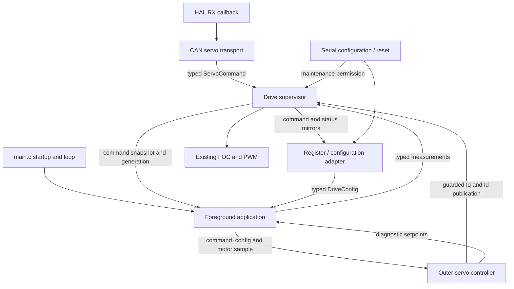

# Professional firmware architecture

Branch `professional`, based on `simplified` at `8629fd6`. The first increment
introduced the typed model and drive supervisor; the second extracted the outer
servo controller; the third extracted CAN handling; the fourth extracts the
foreground application scheduler. All preserve the selected firmware's motor
behavior.

## Current boundaries

| Module | Responsibility |
| --- | --- |
| `drive_types.h` | HAL-independent `DriveConfig`, `ServoCommand`, command snapshot, measurements, state and status types; explicit units and existing gain scales |
| `drive.c` / `drive.h` | Private owner of arming, accepted command, generation, timestamp, maintenance permission and measured-status snapshot; ARM/DISARM, watchdog service and guarded current publication |
| `control_table.c` | Legacy serial/flash register adapter, pure parameter validation, typed configuration reads, command/status mirrors |
| `servo_controller.c` / `servo_controller.h` | Foreground-owned PD/filter history and arm-generation tracking; typed setpoint calculation and guarded publication through the drive supervisor |
| `can_servo.c` / `can_servo.h` | Bound FDCAN handle, private transport buffers, bounded FIFO draining, frame validation, typed command dispatch and four-byte feedback encoding |
| `app.c` / `app.h` | Foreground deadlines/counters, sensor acquisition, controller invocation, measurement/diagnostic publication, periodic services, LED/button and bounded serial processing |
| `main.c` | Peripheral and motor-dependency startup, CAN filters/transceiver/start, HAL forwarding, application initialization and foreground `App_Process` call |
| `foc.c` | Existing FOC modes, current regulation, current/ADC protection, immediate coast, shared FOC watchdog and blocking calibration trajectory |
| `protocol.c` | Serial framing/register requests and persistence, acquiring/releasing maintenance through the supervisor |

The owned `ServoCommand` is authoritative. The legacy goal registers are mirrors
for diagnostics, not a second command owner. `DriveConfig` is currently a typed
snapshot decoded from the existing settings store; configuration persistence has
not been migrated. `DriveStatus` combines owned measurements with current faults,
arming, maintenance and FOC calibration progress. Its state is an application
view, not a replacement for FOC's internal modes or a new CAN telemetry format.

## Execution and transition contract

- `Drive_Init` runs after runtime-register reset and before ADC/CAN reception.
  It starts disarmed and clears command history.
- `CanServo_Init` binds the transport after FOC initialization/service and before
  FDCAN start/notifications. Peripheral setup, filters and transceiver pins remain
  in `main.c`; the HAL receive callback only forwards to `CanServo_OnRxFifo0`.
  Initialization and FIFO processing do not own arming or watchdog state.
- The CAN module accepts callbacks only for its initialized controller and the
  FIFO0 new-message event. It drains at most the FIFO entries present at entry,
  stopping on HAL receive failure. Its private receive buffer holds all 64 bytes
  HAL may copy before an unsupported FD frame/DLC is rejected.
- CAN command acceptance precedes feedback queuing, as before. A full/failed TX
  queue does not undo the command, delay DISARM, retry or extend receive work.
- `App_Init` binds the initialized 1 MHz/16-bit timer and protocol serial handler
  after CAN setup. It initializes controller/scheduler history without changing
  an accepted drive command. `App_Process` is foreground-only and nonreentrant.
- Each application pass services drive watchdogs before sampling the timer once.
  Unsigned 16-bit elapsed times schedule at most one servo update (250 us) and
  one service update (10000 us), in that order. Deadlines advance by their fixed
  periods; catch-up occurs across later passes. Acquisition delays do not cause
  the service decision to take a different timer sample in the same pass.
- Servo work collects the sensor sample, captures typed command/configuration,
  invokes the controller and publishes measurements/diagnostics. Service work
  validates configuration, disarms on invalid settings, runs FOC service, then
  handles the LED, button/calibration and serial bytes. Serial work is bounded
  to the byte count at the start of serial processing, including after calibration.
- Calibration remains blocking and retains the startup-held-button and
  armed-held-button interlocks. No scheduler framework, RTOS or timing-policy
  change is introduced. Counter publication still precedes loop-count increment.
- ARM, DISARM, command submission, reads, watchdog decisions and current
  publication use short critical sections that restore the caller's IRQ mask.
  They can run from foreground or CAN receive context. No dynamic allocation or
  blocking peripheral I/O is introduced in these paths.
- A new ARM increments the generation and initializes measured-position goals
  with zero gains/feed-forward. A duplicate ARM preserves the current command.
- Current publication rechecks permission, faults, calibration and generation
  atomically. An older calculation cannot publish after DISARM/rearm.
- `ServoController_Init` initializes one foreground-owned controller before the
  first servo tick. `ServoController_Update` consumes typed command/configuration
  snapshots and the caller's current motor-shaft position/velocity sample. It
  performs no acquisition, scheduling, register access or direct FOC calls.
- The controller resets PD/filter history on a new arm generation or after a
  rejected publication. Duplicate ARM retains history. A disabled snapshot
  returns zero diagnostic setpoints and rechecks live permission before any
  disable, so it cannot disable a more recent ARM. Returned setpoints describe
  the calculation, even if the supervisor rejects its publication.
- Detected faults can coast immediately inside FOC. `Drive_Service` revokes
  application command permission on the following foreground pass. Clearing a
  recoverable fault does not automatically rearm.
- Maintenance transitions and calibration requests are foreground-only. A
  configuration write requires disarmed, noncalibrating operation. Reset
  maintenance first inhibits ARM and disarms; its interlock remains through the
  reset delay. Parameter validation does not depend on supervisor state.
- `Drive_Run_Calibration` applies application permission checks and delegates to
  FOC. FOC's existing atomic entry guard resolves an ARM arriving between the
  foreground permission check and actual calibration entry. FOC still owns the
  private calibration-active/cancelled flags and trajectory.
- Measurements are collected with ADC interrupts masked, published as a complete
  typed snapshot and mirrored with the existing saturation/encoding. CAN replies
  encode that stored snapshot, preserving their four-byte layout and update age.

## Deliberately unchanged

The 8-byte command format, reserved ARM/DISARM messages, reply ID/layout, serial
register addresses, single-page flash layout, parameter limits, 1000 ms CAN and
10 ms FOC timeouts, encoder timing, PI/PD arithmetic, current limits, overspeed
policy and calibration trajectory remain the baseline behavior. The derivative
is still per sample and CAN commands still supply zero velocity gain.

FOC and encoder internals still read some legacy registers. Startup/peripheral
setup remains in `main.c`. Calibration remains blocking. These are
recorded later increments in the [roadmap](professional-roadmap.md), not hidden
claims of a completed application-wide rewrite. The earlier illustrated guide
shows the baseline integration; this document describes the new extraction.

## Verification

The CAN integration suite links the real `can_servo.c`, `drive.c` and
`control_table.c` as separate production translation units, at `-O0` and `-O2`.
Only the thin main.c HAL adapter and existing FOC watchdog are extracted into
the fixture. Original malformed-frame, watchdog, ARM/DISARM and generation cases
remain, together with typed ownership, feedback, maintenance, calibration entry,
fault and IRQ-mask checks. Added transport checks cover uninitialized/controller
binding, complete TX framing, signed/saturated/NaN feedback and queue failures.
The HAL mock observes receive capacity with GCC/Clang object-size instrumentation
at the call boundary; no test includes or mutates private CAN/supervisor state.
Startup tests also check binding before CAN start and application initialization
after startup dependencies. FOC/calibration/sensor and serial regressions remain
in place.

The servo suite links production `servo_controller.c`, `drive.c`,
`control_table.c`, `pic.c` and `math_tool.c` directly. Numerical expectations and
public-interface sequences cover gain/unit scales, clamping, feed-forward,
direction, per-sample derivative/velocity filters, zero integral gain, disabled
outputs, duplicate ARM, rearm without a disabled tick, stale enabled/disabled
snapshots and faults arriving after command capture. FOC/peripherals are mocked;
tests do not include implementation source or modify private controller state.

Application and telemetry suites directly link production `app.c` and the register
adapter with mocked dependencies, without including or changing private scheduler
state. Application checks cover deadline boundaries, fixed-phase catch-up,
rollover, execution order, delayed acquisition/calibration, watchdog-first
dispatch, configuration faults, button interlocks, bounded serial work and IRQ
restoration. Telemetry counter tests drive public passes instead of injecting
counters; saturation, NaN/infinity and zero-uptime coverage is retained.

Validated on 2026-10-27:

- All thirteen host regression suites passed with native GCC 4.7.0, including
  287 CAN/supervisor, 276 servo and 57 application assertions at each of `-O0`
  and `-O2`, with zero failures.
- Fresh ARM GCC 14.3.1 builds passed at `-Og` and `-O2`. Both retain the
  existing linker warning about a load segment with RWX permissions.
- Baseline comparison confirms no source changes to `foc.c`, `foc_utils.h`,
  `position_sensor.c`, `pic.c` or `math_tool.c`.

This verifies software regressions and compilation. Interrupt duration,
foreground jitter and physical motor behavior still require the recorded bench
checks; the additional snapshot copies have not been timed on hardware.
