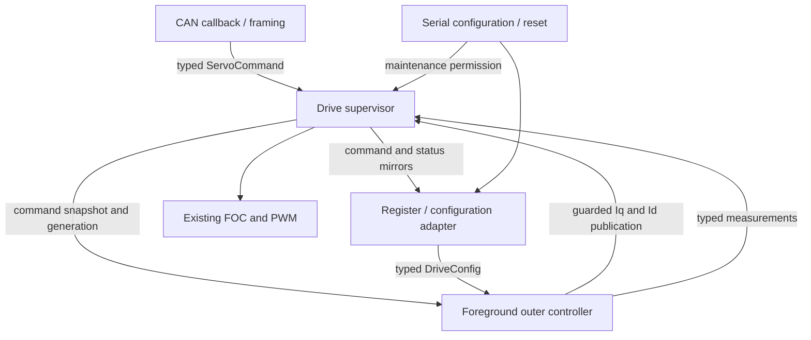

# First professional refactor: typed model and drive supervisor

Branch `professional`, based on `simplified` at `8629fd6`. This increment changes
ownership and interfaces while preserving the selected firmware's motor behavior.

## Current boundaries

| Module | Responsibility |
| --- | --- |
| `drive_types.h` | HAL-independent `DriveConfig`, `ServoCommand`, command snapshot, measurements, state and status types; explicit units and existing gain scales |
| `drive.c` / `drive.h` | Private owner of arming, accepted command, generation, timestamp, maintenance permission and measured-status snapshot; ARM/DISARM, watchdog service and guarded current publication |
| `control_table.c` | Legacy serial/flash register adapter, pure parameter validation, typed configuration reads, command/status mirrors |
| `main.c` | Generated peripheral setup, CAN framing, foreground scheduling, existing outer servo calculation and status collection |
| `foc.c` | Existing FOC modes, current regulation, current/ADC protection, immediate coast, shared FOC watchdog and blocking calibration trajectory |
| `protocol.c` | Serial framing/register requests and persistence, acquiring/releasing maintenance through the supervisor |

The owned `ServoCommand` is authoritative. The legacy goal registers are mirrors
for diagnostics, not a second command owner. `DriveConfig` is currently a typed
snapshot decoded from the existing settings store; configuration persistence has
not been migrated. `DriveStatus` combines owned measurements with current faults,
arming, maintenance and FOC calibration progress. Its state is an application
view, not a replacement for FOC's internal modes or a new CAN telemetry format.

## Execution and transition contract

- `Drive_Init` runs after runtime-register reset and before ADC/CAN reception.
  It starts disarmed and clears command history.
- ARM, DISARM, command submission, reads, watchdog decisions and current
  publication use short critical sections that restore the caller's IRQ mask.
  They can run from foreground or CAN receive context. No dynamic allocation or
  blocking peripheral I/O is introduced in these paths.
- A new ARM increments the generation and initializes measured-position goals
  with zero gains/feed-forward. A duplicate ARM preserves the current command.
- Current publication rechecks permission, faults, calibration and generation
  atomically. An older calculation cannot publish after DISARM/rearm.
- Detected faults can coast immediately inside FOC. `Drive_Service` revokes
  application command permission on the following foreground pass. Clearing a
  recoverable fault does not automatically rearm.
- Maintenance transitions and calibration requests are foreground-only. A
  configuration write requires disarmed, noncalibrating operation. Reset
  maintenance first inhibits ARM and disarms; its interlock remains through the
  reset delay. Parameter validation does not depend on supervisor state.
- `Drive_Run_Calibration` applies application permission checks and delegates to
  FOC. FOC's existing atomic entry guard resolves an ARM arriving between the
  foreground permission check and actual calibration entry. FOC still owns the
  private calibration-active/cancelled flags and trajectory.
- Measurements are collected with ADC interrupts masked, published as a complete
  typed snapshot and mirrored with the existing saturation/encoding. CAN replies
  encode that stored snapshot, preserving their four-byte layout and update age.

## Deliberately unchanged

The 8-byte command format, reserved ARM/DISARM messages, reply ID/layout, serial
register addresses, single-page flash layout, parameter limits, 1000 ms CAN and
10 ms FOC timeouts, encoder timing, PI/PD arithmetic, current limits, overspeed
policy and calibration trajectory remain the baseline behavior. The derivative
is still per sample and the velocity-field contribution is still zero.

FOC and encoder internals still read some legacy registers. The outer controller
and CAN framing still live in `main.c`. Calibration remains blocking. These are
recorded later increments in the [roadmap](professional-roadmap.md), not hidden
claims of a completed application-wide rewrite. The earlier illustrated guide
shows the baseline integration; this document describes the new extraction.

## Verification

The CAN integration suite now links the real `drive.c` and `control_table.c` as
separate production translation units. Its original malformed-frame, watchdog,
ARM/DISARM and generation cases remain, with new checks for authoritative typed
commands, copied status, unchanged feedback encoding, maintenance, calibration
entry, fault transitions and IRQ-mask preservation. No test includes or mutates
the supervisor's private state. Telemetry tests also link the real register
adapter. Existing FOC/calibration/sensor and serial regressions remain in place.

Validated on 2026-10-26:

- All eleven host regression suites passed with native GCC 4.7.0, including
  265 CAN/supervisor assertions with zero failures.
- Fresh ARM GCC 14.3.1 builds passed at `-Og` and `-O2`. Both retain the
  existing linker warning about a load segment with RWX permissions.
- Baseline comparison confirms no source changes to `foc.c`, `foc_utils.h`,
  `position_sensor.c`, `pic.c` or `math_tool.c`.

This verifies software regressions and compilation. Interrupt duration,
foreground jitter and physical motor behavior still require the recorded bench
checks; the additional snapshot copies have not been timed on hardware.
