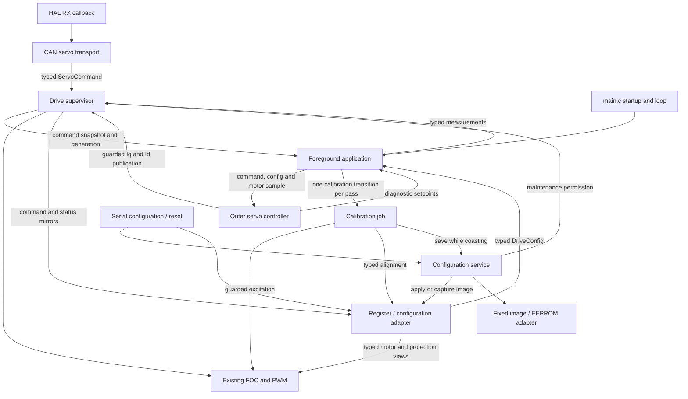

# Professional firmware architecture

This is the preserved `professional` baseline. Branch `standalone` adds local
input acquisition and road-speed PID before the servo update, and defaults
to a local command owner. See [standalone.md](standalone.md) for those additions.

For a first tour of the actual source, use the [firmware reading guide](code-guide/README.md).
Its [function index](code-guide/function-index.md) and [type catalogue](code-guide/types.md)
explain every selected Core function/type, including private and platform support.

Branch `professional`, based on `simplified` at `8629fd6`. The first increment
introduced the typed model and drive supervisor; the second extracted the outer
servo controller; the third extracted CAN handling; the fourth extracted the
foreground application scheduler; the fifth added typed low-level motor/fault
boundaries; the sixth separated configuration validation, application and storage.
The seventh advanced calibration motion through explicit foreground states;
the eighth aligned conventions, interface contracts and current references.
The control calculations and normal command behavior are preserved.

Names, numeric scales, caller/pointer/IRQ obligations and error returns are
recorded in [firmware-conventions.md](firmware-conventions.md) and module headers.
Application APIs use `Module_Action` (for example `Drive_RequestArm`); low-level
motor/driver interfaces keep their established names. Raw command gains explicitly
use `_raw` fields. Sensor readiness/init are boolean; readiness reports successful
initialization and must be combined with live fault flags after acquisition.

## Current boundaries

| Module | Responsibility |
| --- | --- |
| `drive_types.h` | HAL-independent `DriveConfig`, `ServoCommand`, command snapshot, measurements, state and status types; explicit units and existing gain scales |
| `drive.c` / `drive.h` | Private owner of arming, accepted command, generation, timestamp, maintenance permission and measured-status snapshot; ARM/DISARM, watchdog service and guarded current publication |
| `control_table.c` | Legacy register/default encoding, typed reads, coherent configuration image capture/application and runtime mirrors; no flash I/O |
| `config_validation.c` | Pure typed safety validation and current-value validation |
| `configuration.c` / `configuration.h` | Startup load/provisioning, guarded configuration writes/reset, image snapshot/save and storage-fault handling |
| `config_storage.c` / `config_storage.h` | Fixed 128-byte image contract and EEPROM I/O adapter, with no drive or parameter policy |
| `motor_config.c` / `motor_config.h` | Narrow live motor/protection/alignment views; coherent calibration alignment access, torque-permission view and encoder diagnostic counter adapter |
| `drive_faults.c` / `drive_faults.h` | Named eight-bit fault masks and live diagnostic-byte access; atomic set/clear with unchanged bit assignments and recovery policies |
| `servo_controller.c` / `servo_controller.h` | Foreground-owned PD/filter history and arm-generation tracking; typed setpoint calculation and guarded publication through the drive supervisor |
| `can_servo.c` / `can_servo.h` | Bound FDCAN handle, private transport buffers, bounded FIFO draining, frame validation, typed command dispatch and four-byte feedback encoding |
| `app.c` / `app.h` | Foreground deadlines/counters, sensor acquisition, controller invocation, measurement/diagnostic publication, periodic services, LED/button and bounded serial processing |
| `calibration.c` / `calibration.h` | Foreground calibration trajectory, settling/capture states, original alignment, completion result and persistence/rollback orchestration |
| `main.c` | Peripheral and motor-dependency startup, CAN filters/transceiver/start, HAL forwarding, application initialization and foreground `App_Process` call |
| `foc.c` | Existing FOC modes, current regulation, current/ADC protection, immediate coast, shared FOC watchdog and atomic calibration excitation/cancellation primitives |
| `protocol.c` | Serial framing/register reads, LED/reboot and replies; delegates configuration writes/reset to the configuration service |

The owned `ServoCommand` is authoritative. The legacy goal registers are mirrors
for diagnostics, not a second command owner. `DriveConfig` is currently a typed
snapshot decoded from the existing settings store. Persistence has explicit
service/storage boundaries and retains its original format. `DriveStatus`
combines owned measurements with current faults,
arming, maintenance and FOC calibration progress. Its state is an application
view, not a replacement for FOC's internal modes or a new CAN telemetry format.

## Execution and transition contract

- `Drive_Init` runs after runtime-register reset and before ADC/CAN reception.
  It starts disarmed and clears command history.
- `CanServo_Init` binds the transport after FOC initialization/service and before
  FDCAN start/notifications. Peripheral setup, filters and transceiver pins remain
  in `main.c`; the HAL receive callback only forwards to `CanServo_OnRxFifo0`.
  Initialization and FIFO processing do not own arming or watchdog state.
- The CAN module accepts callbacks only for its initialized controller and the
  FIFO0 new-message event. It drains at most the FIFO entries present at entry,
  stopping on HAL receive failure. Its private receive buffer holds all 64 bytes
  HAL may copy before an unsupported FD frame/DLC is rejected.
- CAN command acceptance precedes feedback queuing, as before. A full/failed TX
  queue does not undo the command, delay DISARM, retry or extend receive work.
- `App_Init` binds the initialized 1 MHz/16-bit timer and protocol serial handler
  after CAN setup. It initializes controller/calibration/scheduler history
  without changing an accepted drive command. `App_Process` is foreground-only
  and nonreentrant.
- Each application pass services drive watchdogs before sampling the timer once.
  Unsigned 16-bit elapsed times schedule at most one servo update (250 us) and
  one service update (10000 us), in that order. Deadlines advance by their fixed
  periods; catch-up occurs across later passes. Acquisition delays do not cause
  the service decision to take a different timer sample in the same pass.
- Servo work collects the sensor sample, captures typed command/configuration,
  invokes the controller unless calibration owns excitation, and publishes
  measurements/diagnostics. During calibration, diagnostic servo setpoints are
  zero while measured telemetry remains live. Service work
  validates configuration, disarms on invalid settings, runs FOC service, then
  handles the LED, button/calibration and serial bytes. Serial work is bounded
  to the byte count at the start of serial processing.
- Calibration advances after normal jobs on every pass, with at most one state
  transition and no busy waits or duplicate acquisition/protection scheduler.
  Startup-held-button and armed-held-button interlocks remain. Counter publication
  still precedes loop-count increment. No scheduler framework or RTOS is added.
- ARM, DISARM, command submission, reads, watchdog decisions and current
  publication use short critical sections that restore the caller's IRQ mask.
  They can run from foreground or CAN receive context. No dynamic allocation or
  blocking peripheral I/O is introduced in these paths.
- A new ARM increments the generation and initializes measured-position goals
  with zero gains/feed-forward. A duplicate ARM preserves the current command.
- Current publication rechecks permission, faults, calibration and generation
  atomically. An older calculation cannot publish after DISARM/rearm.
- FOC consumes one narrow, coherent `MotorControlConfig` snapshot per update,
  retaining the existing gain divisions and angle arithmetic. Alignment is signed
  degrees; manual trim is unsigned degrees, matching the legacy byte encoding.
  Protection services consume typed temperature/bus limits. The live permission
  accessor preserves the existing nonzero torque-register semantics.
- Motor snapshots and complete alignment writes restore the caller's IRQ mask.
  They decode the existing image on demand, with no cached copy or new apply
  policy. Calibration alignment rollback uses the same original bits; persistence
  delegates through `Config_Save` to unchanged whole-image storage.
- Fault access uses named `DriveFault` masks and an eight-bit `DriveFaultFlags`
  value. The diagnostic byte remains authoritative. Reads stay live; set/clear
  preserve unrelated flags atomically. Fast motor/permission readers and fault
  helpers execute from CCMRAM. Encoder read-error accounting retains the existing
  wrapping diagnostic byte even though its legacy register name refers to CRC.
- `ServoController_Init` initializes one foreground-owned controller before the
  first servo tick. `ServoController_Update` consumes typed command/configuration
  snapshots and the caller's current motor-shaft position/velocity sample. It
  performs no acquisition, scheduling, register access or direct FOC calls.
- The controller resets PD/filter history on a new arm generation or after a
  rejected publication. Duplicate ARM retains history. A disabled snapshot
  returns zero diagnostic setpoints and rechecks live permission before any
  disable, so it cannot disable a more recent ARM. Returned setpoints describe
  the calculation, even if the supervisor rejects its publication.
- Detected faults can coast immediately inside FOC. `Drive_Service` revokes
  application command permission on the following foreground pass. Clearing a
  recoverable fault does not automatically rearm.
- Maintenance transitions and calibration requests are foreground-only. A
  configuration write requires disarmed, noncalibrating operation. Reset
  maintenance first inhibits ARM and disarms; its interlock remains through the
  reset delay. Parameter validation does not depend on supervisor state.
- `Config_Validate` checks a supplied typed value without changing state;
  `Config_IsValid` validates a coherent live view. `Config_ApplyRegisterWrite`
  checks the configuration-only range and acquires maintenance before copying
  bytes. Partial disarmed repairs remain supported; invalid intermediate values
  are stored, with the existing safety checks preventing ARM/continued operation.
- `Config_Save` requires startup, maintenance or calibration exclusion and IRQs
  enabled. It atomically captures bytes 0x00..0x7f into a bounded local image,
  then performs I/O outside that critical section. Failures latch the internal
  fault; applied serial-write RAM values remain applied. Calibration retains its
  own alignment rollback. No flash rollback or power-loss transaction is claimed.
- `Config_Load` provisions an empty page or loads the existing image before
  drive/ADC/CAN initialization. It retains invalid stored values for repair;
  current-value validation still prevents arming. A failed read now reports the
  internal fault and returns failure to startup before any image application.
  `Config_FactoryReset` preserves the reset-delay maintenance guard on success
  and releases it on storage failure. Serial error/reply mappings are unchanged.
- `Drive_StartCalibration` checks application permission and starts the foreground
  job. FOC's atomic entry guard resolves an ARM arriving between the permission
  check and entry. FOC owns the private active/cancelled flags and guarded
  excitation/coast primitives; `calibration.c` owns the trajectory and result.
- Measurements are collected with ADC interrupts masked, published as a complete
  typed snapshot and mirrored with the existing saturation/encoding. CAN replies
  encode that stored snapshot, preserving their four-byte layout and update age.

## Calibration job

`Calibration_Start` rejects an active job or unread completion. After FOC accepts
entry, the job saves the original alignment and begins in coast. Each
`Calibration_Update` first checks cancellation, faults, sensor readiness and the
shared FOC watchdog, including after potentially slow serial/acquisition work.
Normal sensor acquisition and protection service stay in `app.c`.

| Phase | Transition |
| --- | --- |
| Coast | After 200 ms, apply temporary zero alignment and excite at 3 pi / 2, 3 V |
| Initial settle | After 100 ms, start forward position 0 |
| Forward | Positions 0..500 inclusive, angle = 3 pi / 2 + 2 pi * step / 500; dwell 2 ms at each |
| Forward settle/capture | Hold 200 ms, then capture the angle on a later acquisition pass |
| Reverse | Positions 500..0 inclusive with the same angle formula and dwell |
| Reverse settle/capture | Hold 200 ms, then capture a fresh angle, coast, check motion/pole pairs and select direction |
| Alignment settle/capture | Excite angle 0 at 3 V for 1000 ms, capture a fresh angle on a later acquisition pass and calculate the existing offset |
| Save/complete | Coast, save on the following pass, publish result and release the active guard last |

Dwell timestamps are taken after publishing each target. Late foreground work
extends a dwell; the job never catches up with a burst of angle steps. Capture
states wait for a subsequent normal acquisition, so a sample taken just before
the settling deadline is not reused. Synchronous I2C can still delay foreground
work up to its existing timeout.

DISARM immediately coasts and marks cancellation; the following job update
cleans up. Other faults/readiness loss and FOC age over 10 ms also cancel. A
failed/cancelled job restores the original RAM alignment. Completion codes remain
0 success, 1 no motion, 2 pole mismatch, 3 rejected/cancelled/fault, 4 storage
failure. `Calibration_TakeResult` consumes completion once; the application prints
the result without blocking on the motion sequence.

The active guard excludes ARM and configuration maintenance until all cleanup,
result publication and storage finish. Serial reads/diagnostics continue during
motion; configuration writes return the serial access error while calibration
excludes maintenance. Factory-reset/reboot requests are ignored without a reply
during calibration; no new serial busy status is defined.
The final `Config_Save` is synchronous with IRQs enabled while coasting. A
cancellation arriving during that save is reported and restores RAM, but cannot
roll back a flash write already performed. Storage failure retains code 4 and
the internal fault. This refactor introduces no flash transaction guarantees.

## Deliberately unchanged

The 8-byte command format, reserved ARM/DISARM messages, reply ID/layout, serial
register addresses, single-page flash layout, parameter limits, 1000 ms CAN and
10 ms FOC timeouts, encoder timing, PI/PD arithmetic, current limits, overspeed
policy and calibration trajectory remain the baseline behavior. The derivative
is still per sample and CAN commands still supply zero velocity gain.

FOC/PWM and encoder consumers use typed interfaces; their adapters retain the
legacy register image. Storage still uses the original single page without CRC
or transactional recovery. Startup/peripheral setup remains in `main.c`.
Bench/control/reliability decisions remain in the [roadmap](professional-roadmap.md).
The earlier illustrated guide
shows the baseline integration; this document describes the new extraction.

## Verification

The CAN integration suite links the real `can_servo.c`, `drive.c` and
`control_table.c` as separate production translation units, at `-O0` and `-O2`.
Only the thin main.c HAL adapter and existing FOC watchdog are extracted into
the fixture. Original malformed-frame, watchdog, ARM/DISARM and generation cases
remain, together with typed ownership, feedback, maintenance, calibration entry,
fault and IRQ-mask checks. Added transport checks cover uninitialized/controller
binding, complete TX framing, signed/saturated/NaN feedback and queue failures.
The HAL mock observes receive capacity with GCC/Clang object-size instrumentation
at the call boundary; no test includes or mutates private CAN/supervisor state.
Startup tests also check binding before CAN start and application initialization
after startup dependencies. FOC/calibration/sensor and serial regressions remain
in place.

The servo suite links production `servo_controller.c`, `drive.c`,
`control_table.c`, `pic.c` and `math_tool.c` directly. Numerical expectations and
public-interface sequences cover gain/unit scales, clamping, feed-forward,
direction, per-sample derivative/velocity filters, zero integral gain, disabled
outputs, duplicate ARM, rearm without a disabled tick, stale enabled/disabled
snapshots and faults arriving after command capture. FOC/peripherals are mocked;
tests do not include implementation source or modify private controller state.

Application and telemetry suites directly link production `app.c` and the register
adapter with mocked dependencies, without including or changing private scheduler
state. Application checks cover deadline boundaries, fixed-phase catch-up,
rollover, execution order, delayed acquisition, watchdog-first dispatch,
configuration faults, button interlocks, continued acquisition/publication and
serial service during calibration, skipped outer control, one-shot completion,
bounded serial work and IRQ restoration. Telemetry counter tests drive public
passes instead of injecting counters; saturation, NaN/infinity and zero-uptime
coverage is retained.

Configuration tests link the real motor/fault adapters at `-O0` and `-O2` and
cover signed/unsigned fields, gain scales, coherent snapshots, complete alignment
publication/restore, nonzero permission, wrapping diagnostics, all eight fault
bits, unrelated-bit preservation, nested IRQ masks and persistence failures.
Existing suites also link the real fault backend; FOC/encoder/calibration tests
link the motor adapter. CORDIC/FOC checks now include successful gain and angle
consumption as well as the original failure paths and immediate disable.

Configuration tests now also link the real validation/service/storage/register
modules, without including their implementation source. They exercise image
size and runtime exclusion, existing/empty/invalid image loading, read/write
failures, pure validation, staged repairs, permissions, maintenance lifetime and
factory reset/reserved-byte behavior. Protocol tests link that same production
configuration path; startup checks include a failed load before ADC/CAN startup.

Calibration tests directly link production `calibration.c`, motor/fault adapters
and math helpers at `-O0`/`-O2`. Only the FOC primitives/watchdog are extracted;
peripherals, time and persistence are mocked. Tests observe the complete 500-step
forward/reverse changes, direction/offset, dwell/capture timing, no catch-up burst,
tick rollover, invalid entry, missing encoder, cancellation before/during motion
and storage, FOC loss, no motion/pole mismatch, storage failure, IRQ restoration,
rollback and completion consumption. The job never invokes acquisition or
protection service itself.

The [integration suite](../tests/integration/README.md) now links sixteen real
modules together at `-O0`/`-O2`, covering the CAN/App/controller/calibration and
configuration/serial handoffs with actual AS5600 acquisition. FOC permission,
cancellation and watchdog functions are extracted intact; hardware and the fast
ADC/current/PWM execution are modeled or covered separately. The
[post-refactor audit](professional-regression-audit.md) records the baseline
comparison, confirmed documentation correction and nine integration scenario
groups, including CAN interrupts during acquisition/save and stale calculations.

Validated on 2026-10-27:

- All fourteen host regression suites passed with native GCC 4.7.0, including
  287 CAN/supervisor, 276 servo and 71 application assertions at each of `-O0`
  and `-O2`, plus nine integration scenario groups at both optimizations, with
  zero failures.
- Fresh ARM GCC 14.3.1 builds passed at `-Og` and `-O2`. Both retain the
  existing linker warning about a load segment with RWX permissions.
- The conventions pass changes API/field names, sensor boolean declarations and
  header contracts; the FOC implementation is unchanged from increment seven.
  Its transforms, PI equations, sensing/prediction, limits and fault policies
  are retained. `pic.c`, `math_tool.c` and `as5600.c` remain unchanged.

This verifies software regressions and compilation. Interrupt duration,
foreground jitter and physical motor behavior still require the recorded bench
checks; motor snapshot critical sections and the added interface calls have not
been timed on hardware.
