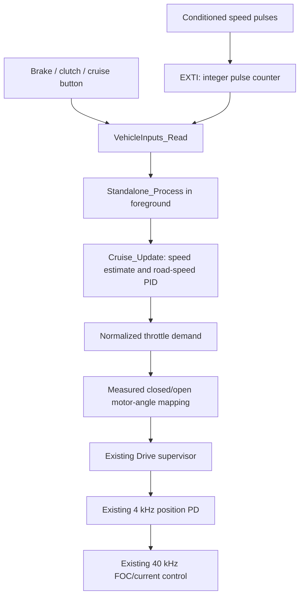

# Standalone cruise control on the STM32G431

Branch `standalone` starts from `professional`. The same MCU now owns the
motorcycle inputs, road-speed PID, motor position controller and FOC/current
loop. No ESP32, MicroPython runtime, extra build system or CAN command source
is required. Existing motor-control and AS5600 algorithms are unchanged.

The software command path is implemented, but the real hardware configuration
is deliberately incomplete. The default image stays disarmed for cruise;
explicit bench calibration through the existing board button remains available.
Missing setup is reported once through the existing serial diagnostic channel.

## Execution and ownership



`App_Process` calls `Drive_Service` first, then `Standalone_Process`, then the
existing servo and background services. Brake/clutch levels are read on every
foreground pass and cancel before the next servo update. Road-speed processing
runs on a separate millisecond deadline, initially every 20 ms, without replaying
missed steps. GPIO/EXTI work never performs floating-point PID calculations.

Only a fresh, debounced cruise-button press with valid speed and a healthy
drive requests local ARM. The controller captures current speed and initializes
demand from measured motor angle, avoiding an intentional jump to fully closed
or open at engagement. Every accepted local position goal refreshes the existing
drive command watchdog. Drive still owns permission, fault checks, command
generation and guarded current publication.

The default Makefile sets `STANDALONE=1`, which defines `DRIVE_STANDALONE=1`.
CAN peripheral setup/start is skipped and transceiver shutdown is asserted.
The CAN receiver also rejects ARM and servo goals defensively if a custom
caller starts it; a valid DISARM can still cancel. There is one local command
owner. `STANDALONE=0` retains the professional CAN behavior for comparison.

## States and abnormal inputs

- Startup, reset and incomplete configuration: cruise disabled.
- Valid speed and a released button followed by a fresh press: capture speed
  and request ARM; failure leaves the drive disabled.
- Second press, brake or clutch: DISARM/coast and clear PID history.
- Lost/implausible speed, excessive processing gap or invalid arithmetic:
  cancel and require release plus a fresh press after recovery.
- Drive fault, maintenance, calibration or unexpected loss/change of drive
  permission: cancel local cruise; it never automatically rearms.

Brake/clutch assertion is not debounced; cancellation occurs on the next
foreground pass. A button held at startup or during an unsafe input cannot
engage after that input clears. The board's PC10 calibration button remains
separate from the configured motorcycle cruise button. Configured brake/clutch
assertion also cancels manual calibration.

`CruiseResult` exposes `active`, speed validity, measured/target m/s, normalized
demand and a `CruiseReason`. Reasons distinguish unconfigured, warming up,
disabled, active, button-off, brake, clutch, input error, speed timeout/invalid
speed, loop gap, unavailable drive and PID arithmetic failure. These are local
diagnostic states; no EEPROM layout, serial register ABI or CAN telemetry
extension is introduced. `Standalone_GetStatus()` returns a foreground snapshot.

## Required configuration

Edit `Core/Src/standalone_config.c` in the selected firmware project after
choosing/measuring the hardware. These are source settings; motor protection,
encoder alignment and existing drive limits retain their current configuration
path. Source configuration is validated and copied at startup; repair requires
rebuild/restart, rather than changing controller settings during operation.

| Setting | Meaning |
| --- | --- |
| `inputs.wiring_verified` | Explicit confirmation of the actual board wiring and input conditioning |
| `inputs.polarities_configured` | Explicit confirmation that the three switch active levels were selected |
| `inputs.maximum_pulses_per_ms` | Required pulse-burst ceiling, 1..100 edges in one HAL tick; choose from actual maximum speed/pulse density and verify on the bench |
| `inputs.speed/brake/clutch/button` | Distinct GPIO port/pin; switches also supply `GPIO_PIN_SET` or `GPIO_PIN_RESET` as their asserted level |
| `cruise.wheel_circumference_m` | Measured rolling wheel circumference in metres |
| `cruise.pulses_per_revolution` | Rising pulses per wheel revolution, including any sensor gearing |
| `cruise.minimum_speed_mps`, `maximum_speed_mps` | Allowed engagement/operating envelope |
| `cruise.kp` | Normalized throttle / (m/s), strictly positive |
| `cruise.ki` | Normalized throttle / ((m/s) × s); zero disables accumulation |
| `cruise.kd` | Normalized throttle / (m/s²); zero disables derivative contribution |
| `closed_position_deg`, `open_position_deg` | Measured motor-shaft angles for actuator travel; either direction is supported |
| `position_kp_raw`, `position_kd_raw` | Existing encoded position-controller gains; proportional gain must be nonzero |

Geometry, speed range, gains, travel and GPIOs have no assumed production
values. The source leaves them zero/unassigned, so configuration validation
fails before input GPIO setup or local ARM. Travel must fit live drive position
limits and the existing 0.1-degree command representation. No fixed final gear
ratio is encoded. Tracking at engagement also requires measured motor position
to lie within the configured closed/open travel.

Provisional timing is 20 ms processing, 100 ms maximum processing gap, a 100 ms
pulse averaging window, 500 ms speed timeout, 30 ms button debounce and a 0.1 s
derivative filter time constant. Choose these against the real pulse density,
speed range and measured foreground timing. Empty windows hold the last valid
speed until the timeout; between pulses the estimator cannot infer exact speed.
The burst ceiling must accommodate at least the rounded-up theoretical pulse
rate at the configured maximum speed; inconsistent settings are rejected before
GPIO setup. Leave any additional margin based on measured signal timing.

## GPIO constraints

All motorcycle signals must be conditioned/protected to compatible logic
levels with defined external bias. No pull resistor, sensor electrical type or
active polarity is inferred. A GPIO reading alone cannot detect every broken
wire or stuck switch. No OEM ABS interface is implemented.

The current candidate whitelist is PA15, PB6, PA11 and PB9. This excludes PWM
power outputs, current/voltage sensing, AS5600 PB7/PB8, serial PB3/PB4, SWD and
the calibration button. ST's [UM2516, Table 4](https://www.st.com/resource/en/user_manual/dm00564746-electronic-speed-controller-discovery-kit-for-drones-with-stm32g431cb-stmicroelectronics.pdf)
identifies PA15 as the PWM input, PB6 as Hall/encoder input and PA11/PB9 as CAN.

**This whitelist is a software constraint, not an approved wiring plan.** The
former CAN pins remain physically connected to the onboard transceiver.
Disabling CAN does not turn the CANH/CANL connector into GPIO. Accessing those
MCU signals requires review of the board schematic and appropriate isolation/
modification of the transceiver connections. If that is impractical, the input
interface/binding must be revised before setting `wiring_verified`; do not use
occupied motor-control pins as substitutes.

The configured speed pin uses rising-edge EXTI at priority 5, below motor ADC,
CORDIC and serial interrupts. Its handler increments one wrapping 32-bit
counter and checks a configured per-tick pulse-burst ceiling. Exceeding it
latches input failure and disables the speed IRQ until restart, bounding work
during an edge storm. This ceiling is a protection limit, not a validated
maximum sampling rate. Foreground snapshots preserve the caller's IRQ mask; speed arithmetic
handles normal counter and millisecond-tick rollover. Counter discontinuities
and excessive computed speed invalidate the measurement. Electrical edge
filtering, maximum pulse frequency and interrupt loss need bench validation.

## PID and actuator mapping

```text
error = captured_target_mps - measured_speed_mps
P = kp * error
I = previous_I + ki * error * actual_elapsed_seconds
D = filtered negative derivative of measured speed
demand = clamp(P + I + kd * D, 0, 1)
motor_position_deg = closed_position_deg
                   + demand * (open_position_deg - closed_position_deg)
```

Conditional integration prevents accumulation further into saturation.
Derivative-on-measurement avoids a target-change kick. Calculated PID state is
committed only after finite-arithmetic checks. Cancellation zeros the target,
output and integral/derivative history. There is no new motor position integral
and no change to current-loop PI.

The existing servo receives zero velocity/current feed-forward in this
increment. A throttle-spring feed-forward table is still deferred. Calibration
and tuning must establish the actual relationship between motor angle, actuator
travel and throttle opening; the code does not estimate it from a guessed ratio.

## Module and function reference

| Module / function | Purpose and calls |
| --- | --- |
| `Cruise_ValidateConfig` | Pure geometry, timing, speed-envelope and finite-gain checks; rejects NULL |
| `Cruise_Init` | Validates/captures configuration before clearing caller-owned history, calls `Cruise_Cancel`, then installs valid settings |
| `Cruise_Cancel` | Clears engagement/PID history and restores the button release interlock |
| `begin_speed` / `update_speed` | Private pulse/time baselines, averaging, rollover, timeout and plausibility checks |
| `button_pressed` | Private stable-level debounce producing one event per accepted press |
| `update_pid` | Private elapsed-time PID, derivative filter, anti-windup and output limits |
| `Cruise_Update` | Validates input/drive readiness, updates speed and button state, captures target or updates PID; returns `CruiseResult` |
| `VehicleInputs_Init` / `valid_pin` | Validates wiring/unique candidate pins before setting GPIO modes and enabling EXTI; copies `VehicleInputConfig` |
| `VehicleInputs_Read` | Reads a coherent pulse counter and three raw switches into `CruiseInputs` |
| `VehicleInputs_HandleExti` | Forwards the configured speed pin to HAL's EXTI pending-bit handler |
| `HAL_GPIO_EXTI_Callback` / `VehicleInputs_OnPulse` | Counts only the configured speed pin, bounds pulse bursts and latches/disables the IRQ on excess; no floating point or motor-control calls |
| `Standalone_Init` / `travel_valid` | Validates local configuration and actuator travel, initializes input/controller modules |
| `Standalone_Process` / `cancel` | Foreground scheduling/interlocks; calls `Cruise_Update`, motor-angle mapping and Drive ARM/submit/DISARM APIs |
| `Standalone_GetStatus` | Returns the local `CruiseResult` diagnostic snapshot |
| `standalone_config.c` | Immutable source calibration/wiring object, intentionally incomplete by default |
| `drive_mode.h` | Small compile-time mode selector; Makefile supplies the standalone value |
| App/main/interrupt hooks | Initialize/poll standalone before servo work, suppress CAN startup, forward the two speed EXTI vector groups |

`CruiseConfig` carries road-speed calibration/timing/gains. `CruiseController`
owns its copied configuration, pulse/debounce history, PID state and result.
`VehicleInputPin` names one conditioned pin and switch polarity;
`VehicleInputConfig` groups four pins and wiring confirmations.
`StandaloneConfig` groups cruise/input settings and actuator travel/PD gains.
All storage is static or caller-owned. No dynamic allocation or blocking I/O
is added to the new control path.

## Verification and remaining bench work

Use the existing GNU Make and PowerShell regression workflow:

```powershell
make -C 01-Firmware/B-G431B-ESC1-v3 -j4 all
./tests/run.ps1 -Compiler 'C:/path/to/native/gcc.exe'
```

To compare the professional mode, use `STANDALONE=0` with a **separate**
`BUILD_DIR`; Make does not automatically invalidate objects when only flags
change. Other build frontends must add the new sources and explicitly set
`DRIVE_STANDALONE=1` to select this branch's local mode.

The original regression suites remain, and [standalone checks](../tests/standalone/README.md)
exercise the new production modules at `-O0`/`-O2` in both travel directions.
Startup is checked in both modes. ARM builds verify compilation and memory fit.
Neither host tests nor builds establish real-time performance or physical
motor behavior; no flashing or motorcycle operation is claimed.

Software verification for this increment: all 15 suites passed; startup passed
in both modes, and standalone numerical/integration checks passed at `-O0` and
`-O2` in both travel directions. Default and optimized ARM builds passed.
The inherited RWX load-segment linker warning remains. FOC, AS5600 and the
existing motor position-controller implementation were checked unchanged
against `professional`.

Remaining work: choose/verify the four input circuits and pin access, measure
wheel pulse calibration, align and calibrate actuator travel, tune road-speed
and position gains conservatively, measure foreground/cancellation timing under
FOC load, and run the existing drive abnormal-condition/coast tests with the
new local inputs. The previously deferred independent-watchdog and persistence
work remains deferred; moving logic into one MCU does not implement it.
